 

# Hi, I'm Dev Scipio 👋

**Fullstack Developer · Nairobi, Kenya**

I build fast, reliable web products, with a focus on healthtech. I'm a medical laboratory scientist, so I understand LIS, analyzers and clinical workflows from the inside.

I also have a compulsion for automating repetitive tasks. If I have to do something twice, I start wondering whether I can build software to eliminate it entirely.

---

## 🚀 Live Projects

A selection of websites, applications and full-stack systems I've designed and developed.

### Web Applications & Websites

| Project | Description | Live Demo | Source Code |
|---|---|---|---|
| **The Legends Fitness** | Modern gym website featuring classes, coaches, memberships and bookings. | [Live ↗](https://gym-website-amber-gamma.vercel.app/) | [GitHub ↗](https://github.com/SCIPIO666/gym_website) |
| **NuevaZen** | Digital agency website showcasing branding, design, marketing, web development and automation services. | [Live ↗](https://digital-agency-tau-nine.vercel.app/) | [GitHub ↗](https://github.com/SCIPIO666/digital_agency) |
| **Revival Pilates** | Premium Pilates studio website with classes, instructor profiles, pricing and bookings. | [Live ↗](https://pilates-website-nu.vercel.app/) | [GitHub ↗](https://github.com/SCIPIO666/pilates_website) |
| **Affini Consult** | Coastal property consultancy website featuring property sourcing, assessment and acquisition services. | [Live ↗](https://affini-blue.vercel.app/) | [GitHub ↗](https://github.com/SCIPIO666/affini) |

### Full-Stack & Business Applications

| Project | Description | Live Application |
|---|---|---|
| **Spring Hill Medicare** | Medical and laboratory supplies platform, with a product catalogue and business invoicing system. | [Live ↗](https://spring-hill-medicare-limited.onrender.com/) |

### Personal Portfolio

**[Scipio Portfolio ↗](https://scipioportfolio-two.vercel.app/)**

My personal portfolio showcasing my development work, interests and approach to building software.

### Additional Source Projects

| Project | Repository |
|---|---|
| **Charity for a Cause** | [GitHub ↗](https://github.com/SCIPIO666/charity-4-a-course) |

---

<table>
<tr>
<td width="33%" valign="top">

## What I'm Working On

- **Reagent tracker:** inventory and usage tracking for laboratory environments.
- **Spring Hill:** invoicing and storefront platform.
- **Lab LIS MVP:** exploring laboratory information systems.
- Client and volunteer builds for Kenyan businesses and organisations.

</td>
<td width="33%" valign="top">

## Currently

- **Building:** Full-stack applications and healthtech solutions.
- **Learning:** TypeScript, system design, Linux, Docker, nginx and CI/CD.
- **Open to:** Healthtech and software engineering collaborations.
- **Ask me about:** LIS, analyzers, clinical workflows, Prisma, Node, Express, PostgreSQL, React and creative web development.

</td>
<td width="33%" valign="top">

## Tech Stack

**Frontend:** TanStack Query, Zustand, React Hook Form, Zod, shadcn/ui.

**Backend:** JWT authentication, httpOnly cookies, layered architecture (model → service → controller → router).

</td>
</tr>
</table>

---

<table>
<tr>
<td width="33%" valign="top">

## Why Healthtech?

I'm a licensed medical laboratory scientist. My experience working in clinical laboratories gives me firsthand insight into the problems I'm trying to solve with software.

</td>
<td width="33%" valign="top">

## Let's Connect

- **Portfolio:** [Scipio Portfolio](https://scipioportfolio-two.vercel.app/)
- **Freelance:** Zama Systems
- **Email:** eaphoney@gmail.com
- **LinkedIn:** [in/scipio666](https://linkedin.com/in/scipio666)

</td>
<td width="33%" valign="top">

## Quick Bits

- Based in Nairobi, Kenya.
- Healthtech × Fullstack.
- Open to full-time roles.
- Select freelance projects.

</td>
</tr>
</table>

---

### GitHub Stats

---

*Open to full-time developer opportunities and freelance projects.*

